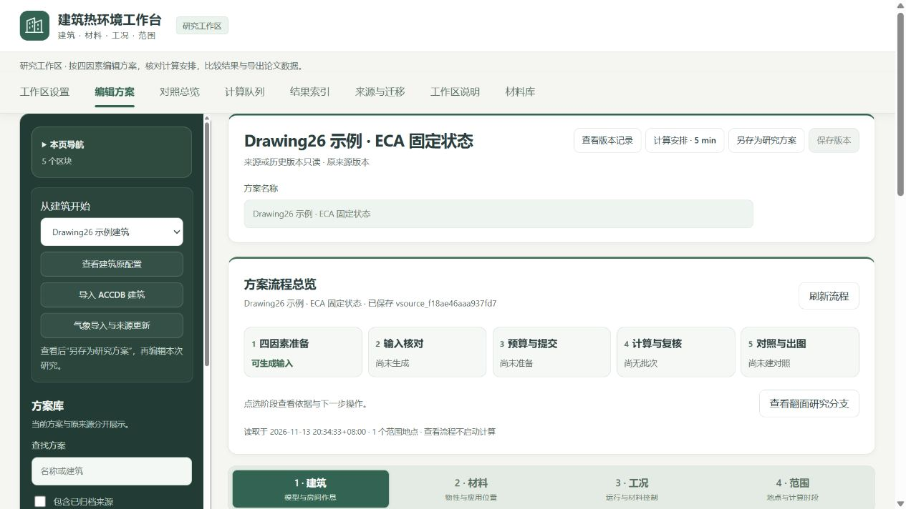
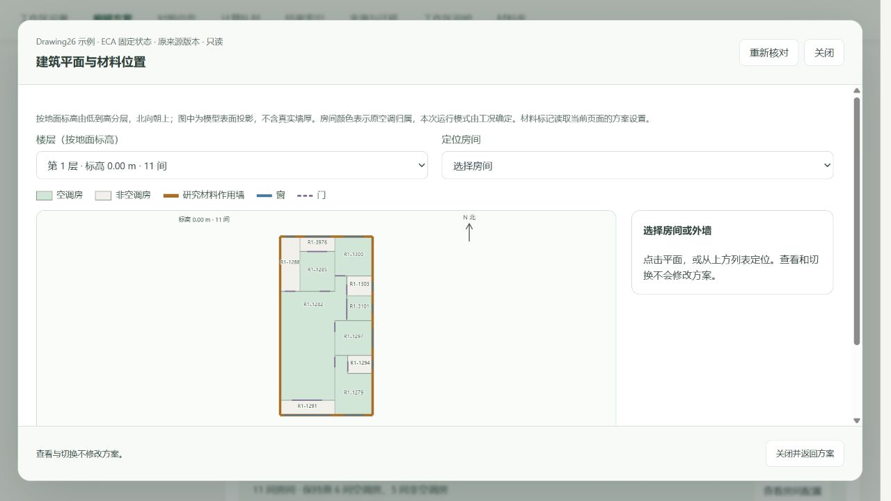

# 建筑热环境工作台

Windows 本地研究工作台，用于整理建筑、材料、工况和计算范围，核对输入后调用 EnergyPlus，再比较和导出建筑显热需求结果。

当前包：**v0.72.2，公开预览版**。自有代码采用 [MIT](LICENSE)，自有示例、结果和文档采用 [CC BY 4.0](LICENSES/CC-BY-4.0.txt)，具体范围与第三方例外见 [版权与许可范围](docs/LICENSE_SCOPE.md)。Copyright (c) 2026 Zhao Bencheng。欢迎未参与开发的使用者按说明完成安装和示例，并反馈实际遇到的问题。



真实界面：Drawing26 / ECA 示例登记后的方案编辑与流程总览，截图中尚未提交计算。

<details>
<summary>查看 Drawing26 建筑平面预览</summary>



示例包含一层、11 个房间；详细模型范围见示例说明。

</details>

- [下载 v0.72.2 公开预览包](https://github.com/YiXueYingCheng/building-thermal-workbench/releases/tag/v0.72.2)
- [下载与解压完整性校验（可选）](docs/VERIFY_DOWNLOAD.md)
- [安装与首次使用](docs/INSTALL.md)
- [从 GitHub 下载并完成首次试用](docs/FIRST_TRIAL.md)
- [Drawing26 / ECA 示例复现](examples/README.md)
- [功能范围与结果解释](docs/SCOPE.md)
- [公用演示配置与 ECA 材料参考](docs/STARTER_LIBRARY.md)
- [已知限制](docs/KNOWN_ISSUES.md)
- [第三方声明](THIRD_PARTY_NOTICES.md)
- [作者与引用](AUTHORS.md)
- [版本说明](CHANGELOG.md)
- [许可范围与署名](docs/LICENSE_SCOPE.md)

运行环境：**Windows、64 位 Python 3.12**，按 `requirements-lock.txt` 自动安装 13 项锁定依赖。

实际计算要求 **EnergyPlus 26.2.0-4bd7a1f26f**（[官方 Windows 发布页](https://github.com/NatLabRockies/EnergyPlus/releases/tag/v26.2.0)），请保留完整安装目录。仅打开空工作台不需要先安装引擎；登记并计算示例时需要。普通 ACCDB/MDB 导入另需 Access ODBC 驱动；专用示例模板登记不依赖该驱动。

在包根目录打开 PowerShell：

```powershell
py -3.12 -m venv .venv
.\.venv\Scripts\python.exe -m pip install -r requirements-lock.txt
if (-not (Test-Path .\building-workbench-next\config.json)) { Copy-Item .\building-workbench-next\config.example.json .\building-workbench-next\config.json }
.\.venv\Scripts\python.exe -B -X utf8 .\building-workbench-next\launch.py --check
.\.venv\Scripts\python.exe -B -X utf8 .\building-workbench-next\launch.py
```

安装后也可双击 `Start Workbench.cmd`。浏览器默认打开 `http://127.0.0.1:8776`，仅在本机监听。首次启动建立空工作区；按示例说明登记后即可创建三类示例，登记不会自动计算。

Drawing26 示例请走专用模板登记入口。源库直接走通用 ACCDB 导入会因一扇门的边界问题停止；本包保留该限制和原始数据，未将模板复现称为通用转换通过。

本包包含已授权的 Drawing26、ECA 参数、复现模板和验收结果；气象从原站按校验值下载。引擎、Python 环境、天气原文件、历史运行缓存和开发记录不随包分发。不要将使用后的整个工作区直接作为源码发布；计算与导出文件可能包含使用者本机路径和项目数据。
